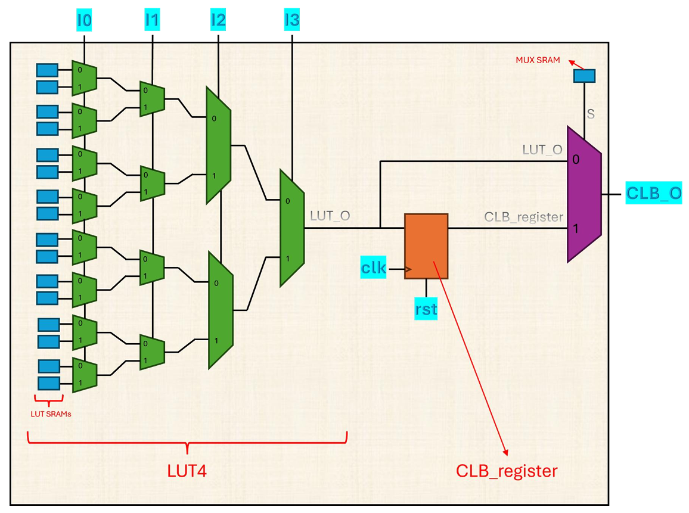
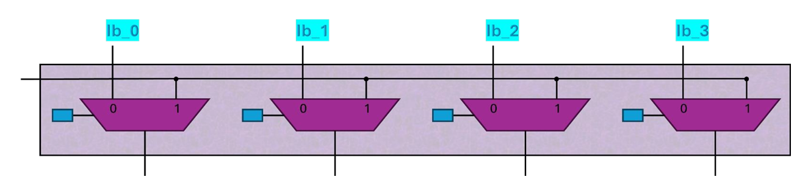
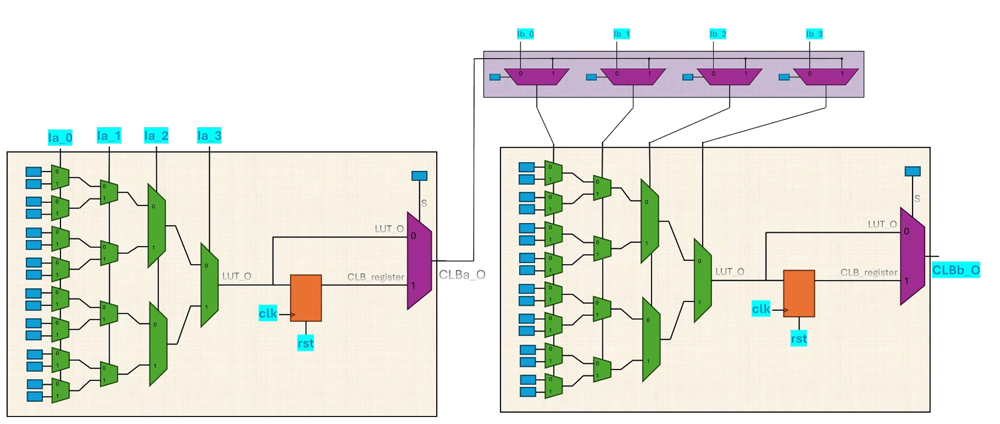

# Custom FPGA Architecture & Bitstream Programming

## Overview
This project involves the RTL design and verification of a simplified, custom Field-Programmable Gate Array (FPGA) architecture. The architecture consists of two Configurable Logic Blocks (CLBs), a programmable routing Connector, and a 38-bit SRAM configuration memory. 

The FPGA is programmed using a serial bitstream, which configures the Look-Up Tables (LUT4s), output registers, and routing multiplexers. To check the functionality, the FPGA is programmed to implement five different logic functions, ranging from purely combinational to pipelined sequential circuits.

**Course:** Digital VLSI System Design (Fall 2026)  
**Institution:** Sharif University of Technology  
**Instructor:** Dr. Shabany

## Architecture
The system is composed of the following modules:

### 1. Configurable Logic Block (CLB)
Each CLB contains:
*   **16 SRAM cells** configuring a 4-input Look-Up Table (LUT4).
*   **1 SRAM cell** configuring a multiplexer that selects between the combinational LUT output or a registered (flip-flop) output.
*   *Total:* 17 SRAM bits per CLB.

*Figure 1: Internal architecture of the Configurable Logic Block (CLB).*

### 2. Connector (Routing Matrix)
The connector routes the output of `CLBa` to the four inputs of `CLBb` via four 2-to-1 multiplexers. The select lines for these muxes are configured via 4 SRAM cells, allowing mapping between the two CLBs.

*Figure 2: The programmable routing matrix (Connector).*

### 3. FPGA Top-Level
The top-level module integrates 2 CLBs and 1 Connector. The programming sequence expects a **38-bit serial bitstream** (17 bits for CLBa, 4 bits for the Connector, and 17 bits for CLBb).

*Figure 3: Complete FPGA top-level architecture showing CLBa, Connector, and CLBb.*

*   **Inputs:** `clk`, `rst_n`, `Ia` (4-bit), `Ib` (4-bit), `bit_stream`, `bit_stream_valid`
*   **Outputs:** `CLBb_O` (1-bit)

## Verification & Implemented Functions
The design is verified using a simple SystemVerilog testbench (`tb_fpga.sv`). The testbench reads the bitstream from `bitstreams.txt`, programs the FPGA, and applies random stimulus. 

The outputs are compared against a behavioral "Golden Model" (`functions.v`). The design successfully implements and verifies the following 5 functions:

1.  **Function 1:** A 4-input truth table (Fully combinational).
2.  **Function 2:** `f = (!a | b) & (c | d)` (Combinational).
3.  **Function 3:** `f = ((a | b) & (!c & d)) ^ e` (Registered output).
4.  **Function 4:** `f = b >= a` (3-bit unsigned comparator, combinational).
5.  **Function 5:** `f = b >= a` (3-bit unsigned comparator, 2-stage pipelined).
